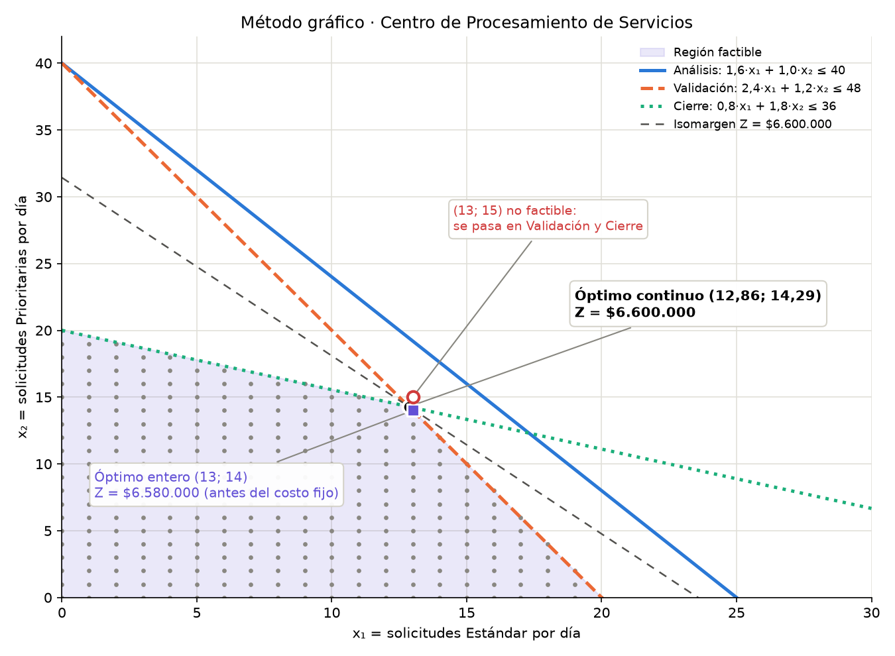

# Centro de Procesamiento de Servicios · Optimización lineal

Caso del Día 1 del curso **Investigación de Operaciones Avanzada** (Doctorado en Ingeniería de Procesos, Universidad EAN): formulación, solución y análisis de sensibilidad de un modelo lineal de asignación de capacidad, más una extensión con variable binaria (costo fijo).

**Página interactiva:** https://saladh1984.github.io/centro-de-servicios/ (o abre `index.html` en el navegador). Explica el caso paso a paso, con ilustraciones, gráficos vinculados y todas las cuentas.

## Método gráfico

[](https://saladh1984.github.io/centro-de-servicios/metodo_grafico.html)

**[Abrir gráfico interactivo](https://saladh1984.github.io/centro-de-servicios/metodo_grafico.html)** · también está dentro de la [sección 3 de la página](https://saladh1984.github.io/centro-de-servicios/#metodo-grafico).

Al mover el cursor (o el dedo) sobre el plano, un panel reemplaza los números del punto en el margen Z y en cada restricción, e indica cuántas horas sobran o faltan. Qué observar:

- **Análisis no es una restricción activa:** su línea pasa entera por fuera de la región factible. En el óptimo usa 34,86 de sus 40 horas, y ningún plan permitido la llena.
- **(13; 15) no es factible aunque esté pegado al óptimo:** necesita 49,2 h de Validación (hay 48) y 37,4 h de Cierre (hay 36). El mejor plan entero es (13; 14), con $6.580.000 de margen antes del costo fijo.

## El problema

El Centro atiende solicitudes **Estándar** (margen $280.000) y **Prioritarias** (margen $210.000), que pasan por tres etapas con capacidad limitada:

| Etapa | h-eq por Estándar | h-eq por Prioritaria | Capacidad (h-eq/día) |
|---|---|---|---|
| Análisis | 1,6 | 1,0 | 40 |
| Validación | 2,4 | 1,2 | 48 |
| Cierre | 0,8 | 1,8 | 36 |

```
max  Z = 280.000 x1 + 210.000 x2
s.a. 1,6 x1 + 1,0 x2 <= 40   (Análisis)
     2,4 x1 + 1,2 x2 <= 48   (Validación)
     0,8 x1 + 1,8 x2 <= 36   (Cierre)
     x1, x2 >= 0
```

## Resultados principales

| Pregunta | Resultado |
|---|---|
| Plan óptimo continuo | 12,86 Estándar + 14,29 Prioritarias → $6.600.000/día |
| Cuellos de botella | Validación y Cierre (Análisis con 5,14 h de holgura) |
| Precios sombra | Análisis $0 · Validación $100.000/h · Cierre $50.000/h |
| Rango de validez de Validación | 24,00 a 56,31 h-eq |
| Oferta de 100 h a $75.000/h | Aumento real $830.769 vs. costo $7.500.000 → no conviene |
| Compra óptima de horas | ≈ 8,31 h → beneficio neto ≈ $207.692/día |
| Plan entero con costo fijo ($450.000) | 13 Estándar + 14 Prioritarias → neto $6.130.000/día |
| Costo fijo crítico del convenio | $980.000/día |
| Rango del margen de la Prioritaria | $140.000 a $630.000 |

**Recomendación:** operar 13 Estándar + 14 Prioritarias, activar el equipo del convenio, rechazar las 100 horas del contratista y negociar solo unas 8.

## Contenido

| Archivo | Descripción |
|---|---|
| `index.html` | Página interactiva (sin dependencias externas) con gráficos vinculados y preguntas y respuestas paso a paso |
| `metodo_grafico.html` | Método gráfico interactivo en un solo archivo (funciona con doble clic) |
| `assets/metodo_grafico_preview.png` | Vista fija del método gráfico |
| `Notebook_Dia1.ipynb` | Notebook de Colab con el modelo en Pyomo + HiGHS y el informe de decisión v1 |
| `scripts/generar_vista_previa.py` | Genera la vista fija con Matplotlib a partir de los datos del modelo |
| `scripts/verificar_modelo.py` | Comprueba con `scipy.optimize.linprog` (HiGHS) el óptimo, los precios sombra y el óptimo entero |
| `requirements.txt` | Librerías para ejecutar el notebook y los scripts localmente |

## Cómo ejecutar el notebook

En Google Colab basta con abrirlo y ejecutar las celdas en orden (la primera instala `pyomo` y `highspy`). En local:

```bash
pip install -r requirements.txt
jupyter notebook Notebook_Dia1.ipynb
```

## Nota

Caso sintético elaborado con fines docentes: la organización y los parámetros son ficticios. Cifras en pesos colombianos (COP).
